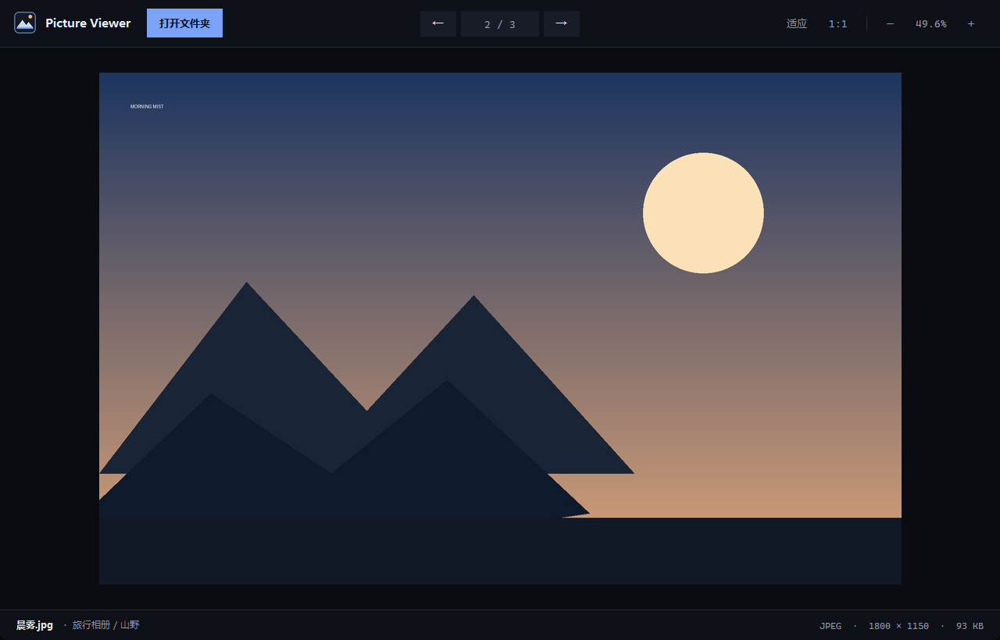

# Picture Viewer

一个专注于「整个文件夹浏览」的轻量图片查看器。打开目录后，方向键即可在所有子文件夹之间连续切换图片，滚轮以鼠标指针为中心平滑缩放。

界面为深色、无干扰设计，只读浏览，不会修改任何图片。



## 功能

- **打开整个文件夹**：递归扫描所有子文件夹，图片按「目录 + 文件名」自然排序（`img2` 在 `img10` 之前）。
- **跨目录连续浏览**：`←` / `→` 到达当前目录末尾时会自动进入下一个目录，不需要反复打开文件。
- **快速跳转目录**：`Ctrl + ←` / `Ctrl + →` 直接跳到上一个或下一个文件夹。
- **鼠标为中心缩放**：滚轮缩放时，指针下方的画面保持不动；放大后拖动鼠标即可平移。
- **大图也流畅**：只渲染视口中可见的图像区域，放大查看大图时不会一次性生成超大位图。
- **常用格式**：支持 Pillow 能打开的主要格式，包括 JPG、PNG、WebP、GIF、TIFF、BMP 等。
- **自动校正方向**：读取 EXIF 方向信息，手机照片不会横躺。
- **后台加载**：扫描文件夹和读取图片在后台线程进行，连续按方向键时界面不会卡死。
- **贴心细节**：适应窗口 / 原始大小、图片尺寸与文件大小、加载失败可重试并继续浏览下一张。

## 快速开始

要求 Python 3.10 或更高版本（Windows 官方安装包自带 Tkinter）。

```bash
pip install -r requirements.txt
python picture_viewer.py
```

打开指定文件夹：

```bash
python picture_viewer.py "D:\Photos"
```

打开某张图片，并浏览它所在的整个文件夹树：

```bash
python picture_viewer.py "D:\Photos\2026\trip.jpg"
```

Windows 下也可以直接双击 `run.bat`。首次运行时会自动安装 Pillow。也可以把文件夹拖到 `run.bat` 上打开。

## 操作

| 操作 | 快捷键 / 鼠标 |
| --- | --- |
| 上一张 / 下一张 | `←` `↑` / `→` `↓` |
| 上一张 / 下一张（翻页） | `PageUp` / `PageDown` |
| 下一张 / 上一张 | `Space` / `Shift + Space` |
| 上一个 / 下一个文件夹 | `Ctrl + ←` / `Ctrl + →` |
| 第一张 / 最后一张 | `Home` / `End` |
| 缩放 | 鼠标滚轮、`+` / `-` |
| 拖动画面 | 按住鼠标左键拖动 |
| 适应窗口 | `F` |
| 原始大小（100%） | `1` |
| 在适应窗口与 100% 间切换 | 双击画面 |
| 打开文件夹 | `Ctrl + O` |

图片循环浏览：到达最后一张后，`→` 会回到第一张。

## 目录与排序规则

- 默认递归扫描全部子文件夹。
- 每个目录中的图片按自然顺序排列；根目录中的图片排在前面，然后按文件夹排序。
- 以 `.` 开头的隐藏目录/文件，以及 Windows 的 `$RECYCLE.BIN`、`System Volume Information` 会被跳过。
- 没有读取权限的目录会被跳过，不会中断扫描。
- 不跟随符号链接，避免循环目录。

## 可选格式

默认只依赖 Pillow。若需要查看 iPhone 的 HEIC/HEIF 照片，可额外安装：

```bash
pip install pillow-heif
```

启动时会自动检测并注册该插件，无需改代码。

GIF、动态 WebP 等动画图片目前显示第一帧。

## 项目结构

```text
pictureviewer/
├── picture_viewer.py     # 应用主程序
├── requirements.txt
├── run.bat               # Windows 一键启动
├── tests/
│   └── test_core.py      # 排序、扫描、分组等核心测试
├── docs/
│   └── preview.png       # README 界面预览
├── README.md
└── .gitignore
```

## 运行测试

```bash
python -m unittest discover -s tests -v
```

测试只覆盖文件发现、自然排序、目录分组和格式化等非 GUI 逻辑，无需显示器。

## 已知限制

- 使用 Tkinter 实现，需要本机有可用的图形桌面环境；不支持在纯命令行服务器中显示界面。
- 图片按需读取，不提供缩略图网格、编辑、删除或写回功能。
- 极端巨大的图片仍受 Pillow 的像素数量安全限制保护。

---

项目地址：<https://github.com/Brohuy/pictureviewer>
